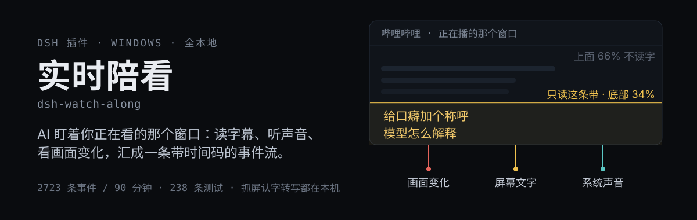
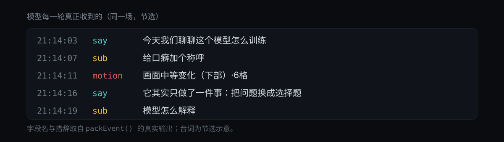

<p align="center">
  
</p>

**实时陪看**是 DSH 的一个插件：它盯着你在浏览器里正在播的**那一个窗口**，把画面变化、屏幕上的字、电脑正在放的声音，变成一条带时间码的事件流交给 AI。AI 因此知道你现在看到哪儿了、画面里在说什么，能跟着你一起看。

它不录屏、不传视频、不替你操作。抓屏、认字、转写都在本机做完；交出去的只有文字事件，以及你主动要的那张拼图。

> **环境必须先备好再谈使用。** 本项目**不代下载、不代安装**任何依赖（Python 包、模型权重、驱动）。缺什么照 [`docs/downloads.md`](docs/downloads.md) 自己备好；我们能查的是代码，查不了你的网络和显卡驱动。

---

## 它和「隔几秒截张图喂给模型」不一样

- **交的是事件，不是截图。** 模型收到的是 `say` / `sub` / `motion` 一条条带时刻的记录，不用自己从图里找话说。10 分钟一场实测只交出 528 条事件 —— 按 8 fps 截屏喂图，那是四千多张。
- **只看该看的地方。** 屏幕文字只认窗口**底部 34%** 那条带（字幕区），其余 66% 只看「有没有动」。这是识别延迟能压到 1.2 秒中位的原因，也是水印和角标会混进来的原因。
- **两种节奏。** 静默观察每 6 秒一轮（只看不说），主动说话默认 30 秒最多一句 —— 第一次开口也要等满 30 秒，不会你一坐下它就抢话。
- **手机能接手。** 同 WiFi 下读事件、现抓一帧、启停采集，不用走回电脑。

<p align="center">
  
</p>

三条通道对应三个字段：

| 字段 | 从哪来 | 说明 |
|---|---|---|
| `say` | 系统输出的声音 → faster-whisper | 本地转写，带起止秒 |
| `sub` | 窗口底部 34% → rapidocr | 只有 1 个汉字的行直接丢 |
| `motion` | 整帧 64×36 网格前后比对 | 带位置（`下部`/`右部`）、强度、格数，可回取那张拼图 |

---

## 怎么用

**第一次装**（详细步骤与离线装法见 [`docs/install.md`](docs/install.md)）：

```cmd
set WATCH_ALONG_WHEELS=D:\path\to\wheels
set WATCH_ALONG_WHISPER_DIR=D:\path\to\whisper-turbo
scripts\setup.cmd
```

**每次用**：

```cmd
set WATCH_ALONG_PY=%CD%\venv\Scripts\python.exe
set WATCH_ALONG_WHISPER_DIR=D:\path\to\whisper-turbo
scripts\start-services.cmd
```

会开两个窗口，**都别关**（关掉对应通道就没了）：

| 窗口 | 端口 | 看到这一行就算好了 |
|---|---|---|
| OCR | 8765 | `[ocr] 模型加载完成` |
| ASR | 8766 | `[asr] 开始连续录音：<你的扬声器名>` |

**然后**：

1. 在 DSH 里说「陪我看这个窗口，标题里有 XXX」；或者在设置面板「测试并锁定匹配窗口」里锁一个，之后直接说「开始陪看」。
2. 想看细节就说「现在什么样」，它取一张拼图。
3. 停下来就说「不用看了」，或等它自己收工。

---

## 要准备什么

| 组件 | 要求 | 不满足会怎样 |
|---|---|---|
| 系统 | Windows 10 2004+ | 起不来（抓屏与录音都是 Windows 接口） |
| Python | 3.12 | 装包失败（wheel 是 3.12 编的） |
| Node.js | ≥ 20 | 插件加载失败 |
| DSH 桌面版 | 当前版本 | 无处安放这个插件 |
| 显卡 | NVIDIA + CUDA 12 / cuDNN 9 | **转写**不可用，画面照常 |
| 磁盘 | 模型约 1.6 GB、wheel 约 1.3 GB | 装不下 |
| 屏幕 | 目标窗口**不能被挡住** | 抓到的是遮挡物 |
| 声音 | 系统音量不能是 0 | 全程没有 `say`，且**不会报错** |
| ffmpeg | ≥ 7，在 PATH 上 | 体检项红；抓屏早已改成原生直抓，不再走 ffmpeg 子进程 |

八项环境检查在设置页第一屏，绿黄红三态，**只读、不提供任何一键下载**。

---

## 面板里有什么

- **环境检查** —— 八项只读，失败时给一句话原因 + 对应下载地址，不替你下。
- **测试并锁定匹配窗口** —— 自动列出当前窗口，点一条填进框；认到底部任意文字就算通过，并锁成默认目标。锁定只在内存，**重启 DSH 后要重锁**。
- **常用设置** —— 帧率、画质、传图档位、字幕开关、声音开关、陪聊提示词、静默提示词、两个间隔。
- **服务** —— OCR 与转写两个 python 服务的启停。

---

## 实测

| 场次 | 时长 | 帧 | 事件（画面/字幕/声音） | OCR p50/p90 | ASR p50/p90 |
|---|---|---|---|---|---|
| 整场直播 | 1 小时 29 分 | 57821 | 2723（613 / 1885 / 225） | — | — |
| 中段十分钟 | 10 分 33 秒 | 4833 | 528（75 / 423 / 30） | 1.2 / 1.4 s | 3.1 / 4.8 s |

一轮 3 分 21 秒的陪看对话：**38 轮 43 步、TTFT 2.1 秒、¥0.068**（折合约 ¥1.2/小时）。全部数据、口径与版本演进在 [`docs/benchmarks.md`](docs/benchmarks.md)（读之前先看那页末尾的「口径坑」）。

---

## 已知限制

1. **只支持 Windows。** 抓屏与录音都是 Windows 接口，没有跨平台的打算。
2. **遮挡无解。** 抓的是屏幕像素，被盖住就抓到遮挡物。用的时候把目标窗口放最前面。
3. **区域在开始时锁定。** 窗口移动或缩放后不会跟随，画面会错位，停掉重开。
4. **底部那条带仍有噪声。** 水印、清晰度角标、播放器控制条会混进 `sub` 事件，实测约 10–17%，靠「汉字 < 2 丢弃」和「相似内容出现 3 次后静音」挡一部分。
5. **整机混音。** 录的是「电脑在放什么」，微信提示音也会进来。BGM 压过人声时会掉字，唱歌会被当成说话。
6. **换输出设备要重启插件**（音箱换耳机之后）。
7. **单显示器。** 副屏与负坐标未支持。
8. **手机端只有接口，没有 App。**

---

## 出问题先看这里

按现象查的表在 [`README.zh.md`](README.zh.md)（速查版，含手机接口清单与开发命令）。三条最常撞上的：

- **没有 `sub` 事件**：静止的纯视频画面本来就没字，先确认画面里真的有字幕。
- **没有 `say` 事件**：先看音量是不是 0，再 `curl -s http://127.0.0.1:8766/` 看 `device` 对不对。
- **手机打不开**：防火墙第一次会拦 8770，允许一下；或 token 拼错。

---

## 致谢

画面链路复用 [dsh-see-now](https://github.com/SAOS-3624/dsh-see-now)（Apache-2.0）；字幕链路的思路与可插拔接口来自 [dsh-streamvision](https://github.com/shet114513/dsh-streamvision)（MIT）；VAD 与幻觉过滤来自 [dsh-better-ears](https://github.com/Destinhue/dsh-better-ears)（MIT）；转写参数参考 [dsh-soundtry](https://github.com/CixiSVesper/dsh-soundtry)。

## 许可证

本项目自己的代码用 [MIT 许可证](LICENSE) —— 拿去改、拿去商用都行，保留版权声明即可。

`vendor/` 下是从上面几个项目搬来的代码，**不算在本项目的 MIT 授权里**，仍按各自原许可证执行（Apache-2.0 / MIT），每个目录里都有对应的 `LICENSE`。

---

**更新记录**：[`CHANGELOG.md`](CHANGELOG.md) —— 只记用户能感知的变化与口径变更。<br>
**设计文档**：`docs/`（含 ADR）；票据与讨论在 `.scratch/watch-along/`。
