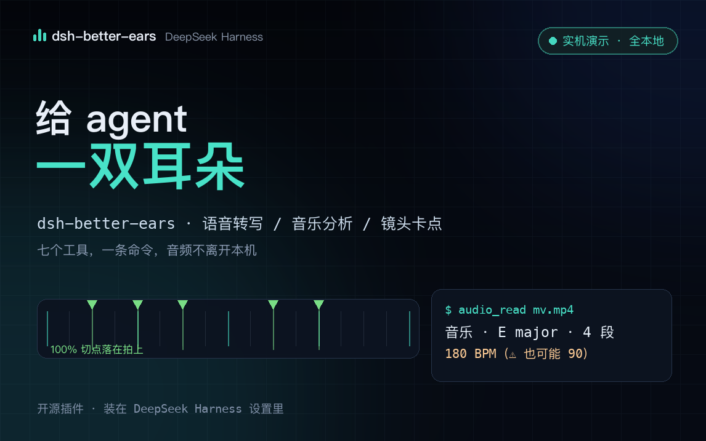

# dsh-better-ears

> 0.2.0 起从 `dsh-ears` 更名为 `dsh-better-ears`。旧名插件请先卸载，再安装本目录；设置页改为 `/dsh-better-ears`，旧 `/dsh-ears` 不再使用。

让 agent 听得见声音。

一个 DeepSeek Harness 插件：**语音**（转写 / 时间戳 / 字幕）、**视频里的声音**（音轨、镜头是否卡在拍上）、**音乐**（速度 / 节拍网格 / 调性 / 和弦 / 曲式）——全部在本机算，不需要上传音频，不按次计费。

思路来自 [dsh-soundtry](https://github.com/CixiSVesper/dsh-soundtry)（「让 agent 听得见声音」，六个本地工具 + 一条诚实的报告风格）。dsh-better-ears 把它的**方法论**搬到了一套这个环境里真的跑得起来的技术栈上：

| | dsh-soundtry | dsh-better-ears |
| --- | --- | --- |
| 运行时 | Python venv + numpy/librosa/faster-whisper | 纯 Node ESM，零 npm 依赖 |
| 语音识别 | 自装 faster-whisper（首次装包 + 下模型） | 复用 DSH 自带的 SenseVoice 识别器，没有就自动加载；再没有就退回接口/命令 |
| 音频解码 | soundfile / ffmpeg | ffmpeg（DSH 自带或系统 PATH） |
| 分析 | librosa | 自写 STFT / HPSS / YIN / 自相关 / 自相似矩阵 |

## 七个工具

| 工具 | 什么时候用 | 回答什么 |
| --- | --- | --- |
| `audio_read` | 默认入口，一个文件先来这一发 | 语音 + 速度 + 拍点 + 调性 + 和弦 + 曲式，一份报告 |
| `audio_speech` | 只要文字 | 逐句转写、时间戳、SRT、说了多久 / 跳过了多少 |
| `audio_rhythm` | 卡点、剪辑、鼓点 | BPM、每个拍点、小节第一拍、镜头切点是否落在拍上 |
| `audio_tonal` | 扒歌、找调 | 调性、和弦走向（只保证根音）、最突出的音高线 |
| `audio_structure` | 歌的结构 | 几段、每段起止、谁和谁重复、段间差在哪 |
| `audio_probe` | 只想先看看 | 流信息、响度（EBU R128）、静音图、画面切点 |
| `audio_status` | 出问题时 | ffmpeg 在哪、识别器装没装好、当前会用哪条通道 |

支持本地文件路径（`~`、相对路径、`file://` 都行），音频和视频都吃——视频自动抽音轨。

## 安装

下载 [`dsh-better-ears-0.2.0.zip`](https://github.com/Destinhue/dsh-better-ears/releases/download/v0.2.0/dsh-better-ears-0.2.0.zip) 解压后安装这个目录；旧版 `dsh-ears` 请先卸载。

把本目录交给 DSH 的插件管理器：**设置 → 插件 → 安装本地插件**，选择 `dsh-better-ears` 目录；或者让 agent 调用 `plugin_manager install_bundle`（`target` 指向本目录）。安装器读取 `dsh.bundle.patch`，把 `dsh-better-ears` 插进当前 profile，重启或热加载后生效。没有配置也能直接跑：DSP 部分只要 ffmpeg。

自检（不需要启动 DSH）：

```bash
node --test test/*.test.js   # 11 项：注册、报告、状态、设置页 token
```

设置入口：**设置 → 插件 → dsh-better-ears**（设置页由 `client.js` 注册；本机 API 页在 `/dsh-better-ears?token=…`，token 每次启动随机，不出现在日志里）。

## 宣传片

两分钟讲清楚它解决什么问题、以及「诚实」这件事：**[promo.mp4](promo/promo.mp4)**（78 秒，1080p，中文字幕）

[](promo/promo.mp4)

片子里的每个数字都是插件在真实素材上跑出来的。素材脚本、渲染脚本和字幕都在 `promo/`，改完重跑两条命令就能出新版。

## 语音识别用哪条通道

`asr.mode = auto`（默认）时按顺序挑：

1. **host** — DSH 里已经有 `speechToText` 服务（例如开了官方的语音输入）。直接用它，模型本来就是本地 SenseVoice。
2. **endpoint** — 配了 OpenAI 兼容接口（`{base}/audio/transcriptions`），就发给它。
3. **command** — 配了命令模板（`{input}` / `{lang}`，或环境变量 `EARS_AUDIO` / `EARS_LANG`），就用外部命令。
4. 都没有 → 报告直接说「没有可用的转写通道」，不猜。

如果 DSH 里**没有** `speechToText` 服务，插件会自己加载安装包里自带的 `@deepseek-ai/dsh-experimental-speech-to-text` + SenseVoice 提供者（provider id `ears-sensevoice`，不与官方 bundle 抢同一个 id）。首次使用需要下载约 240 MB 的 INT8 模型，默认从 `hf-mirror.com` 拉（`huggingface.co` 在不少网络里连不上），可以随时中断、下次继续。

模型目录：`~/.dsh/ears/speech/models`（可在设置里改 `localAsrDataRoot`）。

## 设计上的几条「不许撒谎」

这些是从 soundtry 学来的，也是这个插件和「随便给个数」的区别：

- **BPM 有歧义就说歧义**。半速/倍速/三连音的对手分数和置信度一起打印；`ambiguity` 为 1 时不给你一个假装确定的数字。
- **小节第一拍不确定就说不确定**。四拍循环靠低频能量判定，四个相位差别 < 15% 时输出「归属不确定」并说明原因，而不是硬报一个相位。另外给一个基于和声变化的第二意见。
- **和弦只保证根音**。混音里三度经常被埋掉，性质（大/小/七）会来回跳，报告会标「混合」。
- **调外只看根音**。根音在调内、性质被判成 sus4 时，不会误报「调外」。
- **语音先切再听**。能量 VAD 把音乐/掌声/静音挡在识别器外面（阈值 = max(3×噪声底, 0.25×P90)；动态范围 < 6 dB 时没有可切的静音，就整段交给识别器并说明），报告里必打印 `人声切分：整段 X → N 个有人声片段、并为 W 个识别窗…`；识别结果还会过一遍幻觉词表（「谢谢观看」「字幕由…提供」等），命中就丢弃并计数。转写空着的窗口不会被写成歌词。
- **语音不冒充音乐，音乐也不冒充语音**。`contentKind` 先看调性置信度（真实语音实测 0.28–0.30，真实歌曲 0.88–0.96，0.7 以上直接判音乐），再看低频占比、人声频段占比、脉冲清晰度、速度自证度投票。判成「语音」时不输出调性/和弦/旋律，节拍数字标成仅供参考；判成「音乐」又要求转写时，会说明识别器是给说话训练的，唱词不能当歌词。
- **画面切点分两种**：音乐视频问「切点踩在拍上吗」（容差按画面帧取整，25fps → 一帧 40ms，落在 ±1.5 帧内算准）；说话视频问「切点落在说话停顿处吗」（和 VAD 的句子间隙比，±250ms）。两者都会给出占比、偏差中位数和结论，切点少时不硬下结论。
- **内嵌封面不算视频轨**。MP3 里的封面在 ffprobe 眼里是 video 流（还带 90000/1 的伪帧率），会被单独计数成「内嵌封面 N 张」，不参与卡点分析。

## 性能（本机实测，M 系列 Mac，无 GPU）

| 素材 | 耗时 |
| --- | --- |
| 32 s 音乐，七个维度的完整分析 | ~1.8 s |
| 22.5 s 语音，节拍 + 曲式 + 能量 | ~1.3 s |
| 8 s 视频，探针 + 响度 + 静音 + 切点 | ~0.26 s |
| 3 分 22 秒真实歌曲（MP3，120 s 窗口）的全维度分析 | ~7 s |
| 93.75 s 语音的转写（4 个识别窗） | ~2.9 s（实时率 0.03×）|

内存：节奏分析是流式的一遍过；调性分析按窗口（默认最长 600 s）分块，10 分钟素材不会把频谱全留在内存里。

## 已知局限

- 旋律线跟的是「最突出的有音高线」，混音里通常是贝斯/主旋律，**不保证是人声**。要人声请用 `audio_speech`。
- 曲式检测对「完全重复的两遍」会给 `A` 和 `A'`（相似度 ≥ 86%），但它分不清主歌/副歌，只给字母。
- 转写对长文件按 VAD 分块（默认 ≤ 24 s/块），跨块的句子会被切成两段——时间戳是准的，标点不一定。
- 唱歌不是说话：识别器会硬转写出一些像歌词的东西，插件只能提示「别当真」，不能替你判断唱得对不对。
- 视频只分析**声音**与画面切点；画面内容（人物、场景、字幕）不在这个插件里，用 `video_storyboard`。
- 只处理本地文件；网络 URL 请先下载。

## 目录

```
index.js          apply：配置、工具注册、本地识别器接入、设置服务
client.js         设置页（React，DSH 客户端槽位）
lib/audio.js      ffmpeg / ffprobe：探针、解码、响度、静音、切点、WAV 规范化
lib/analyze.js    分析编排与缓存（节奏/调性/曲式/能量）
lib/dsp/core.js   FFT、STFT、Mel、DCT、统计
lib/dsp/rhy.js    起音包络、速度、节拍 DP、小节相位
lib/dsp/tonal.js  色度图、调性、和弦模板、YIN 旋律
lib/dsp/structure.js  拍同步色度、自相似矩阵、棋盘核、段落标注
lib/asr.js        三种转写通道、VAD 切分、幻觉过滤、SRT
lib/format.js     报告文本（所有不确定性都在这里被打印出来）
lib/tools.js      七个工具的 schema 与执行
lib/settings.js   本机设置 API（token 保护，不回传 key）
test/             11 项离线测试（注册、报告、设置 API）
promo/            宣传片：渲染脚本、旁白文案、成片与封面
```

## License

MIT
