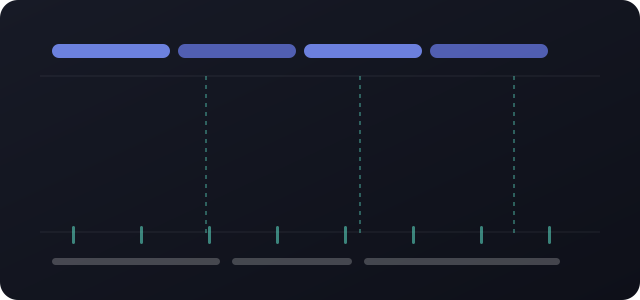

# dsh-better-ears

Audio the agent can actually hear: speech transcription with timestamps, tempo/beat grid/downbeat, key & chords, song structure, loudness, and cut-on-beat — all local, no upload.

## Seven tools

| Tool | Answers |
| --- | --- |
| `audio_read` | Default entry: speech + rhythm + tonal + structure in one report |
| `audio_speech` | Sentence-level transcript, timestamps, SRT, VAD skip stats |
| `audio_rhythm` | BPM, beat grid, downbeat; whether video cuts land on the beat (music) or on speech pauses (talking video) |
| `audio_tonal` | Key, chord roots, dominant pitched line |
| `audio_structure` | Sections, boundaries, which section repeats |
| `audio_probe` | Streams, EBU R128 loudness, silence map, scene cuts |
| `audio_status` | Where ffmpeg is, whether ASR is ready, which transport will be used |

## How it works

- Decode: ffmpeg (DSH-managed copy first, then PATH).
- DSP: hand-written STFT / HPSS / YIN / autocorrelation / self-similarity — pure Node, no numpy.
- Speech: reuse the host `speechToText` service when present; otherwise load the bundled SenseVoice provider (`ears-sensevoice`); otherwise fall back to an OpenAI-compatible endpoint or a local command.
- VAD before ASR: music, applause and silence never reach the recognizer; hallucinated subtitle boilerplate is dropped and counted.

## Install

Install this directory through the DSH plugin manager (`plugin_manager install_bundle`), or add it to the profile dependencies. `cordis.patch.yml` inserts `dsh-better-ears`. Settings live under **Settings → Plugins → dsh-better-ears**.

Self-check: `node --test test/*.test.js`.

## Limits

- Local files only; download URLs first.
- Video: audio and cut points only, not visual content.
- Sung lyrics are not speech: the recognizer will emit something lyric-shaped, and the report can only warn you.
- The pitched line is the most prominent pitched source, not necessarily the voice.
- First local ASR use downloads a ~240 MB INT8 model (hf-mirror first).
- Long transcripts are chunked by VAD (≤24 s by default); timestamps are exact, punctuation may not be.
