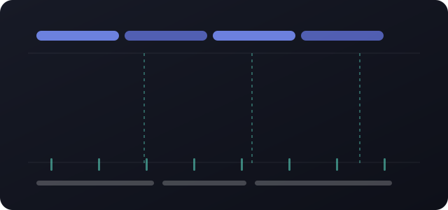

# dsh-better-ears

让 agent 听得见声音：**语音**转写与时间戳、**音乐**的速度/调性/和弦/曲式、**视频里的声音**与画面切点。全部在本机完成，不上传音频。

## 七个工具

| 工具 | 回答什么 |
| --- | --- |
| `audio_read` | 默认入口：语音 + 节奏 + 调性 + 曲式，一份报告 |
| `audio_speech` | 逐句转写、时间戳、SRT、VAD 跳过多少 |
| `audio_rhythm` | BPM、拍点、小节第一拍；镜头切点是踩拍（音乐）还是落在说话停顿处（口播） |
| `audio_tonal` | 调性、和弦根音走向、最突出的音高线 |
| `audio_structure` | 几段、每段起止、哪段和哪段像 |
| `audio_probe` | 流信息、EBU R128 响度、静音图、画面切点 |
| `audio_status` | ffmpeg 在哪、识别器就绪没有、会走哪条通道 |

## 技术路线

- 解码：ffmpeg（DSH 自带优先，其次 PATH）。
- DSP：自写 STFT / HPSS / YIN / 自相关 / 自相似矩阵，纯 Node，无 numpy。
- 语音：优先复用 DSH 的 `speechToText`；没有就自动加载安装包里的 SenseVoice（provider `ears-sensevoice`），再没有就退回 OpenAI 兼容接口或本地命令。
- VAD 先切再识别：音乐、掌声、静音不送进识别器；识别结果过一遍幻觉词表，命中就丢弃并计数。

## 安装

在 DSH 的插件管理里安装本目录（`plugin_manager install_bundle`），或把目录放进 profile 的依赖。`cordis.patch.yml` 会插入 `dsh-better-ears`。设置页在 **设置 → 插件 → dsh-better-ears**。

自检：`node --test test/*.test.js`（10 项）。

## 边界

- 只处理本地文件；网络 URL 先下载。
- 视频只看声音与切点，不看画面内容。
- 旋律线是“最突出的有音高线”，不保证是人声。
- 首次本地识别需下载约 240 MB 的 INT8 模型，默认从 hf-mirror 拉。
- 转写按 VAD 分块（默认 ≤24 s/块），跨块句子会被切开；时间戳准，标点不一定。
